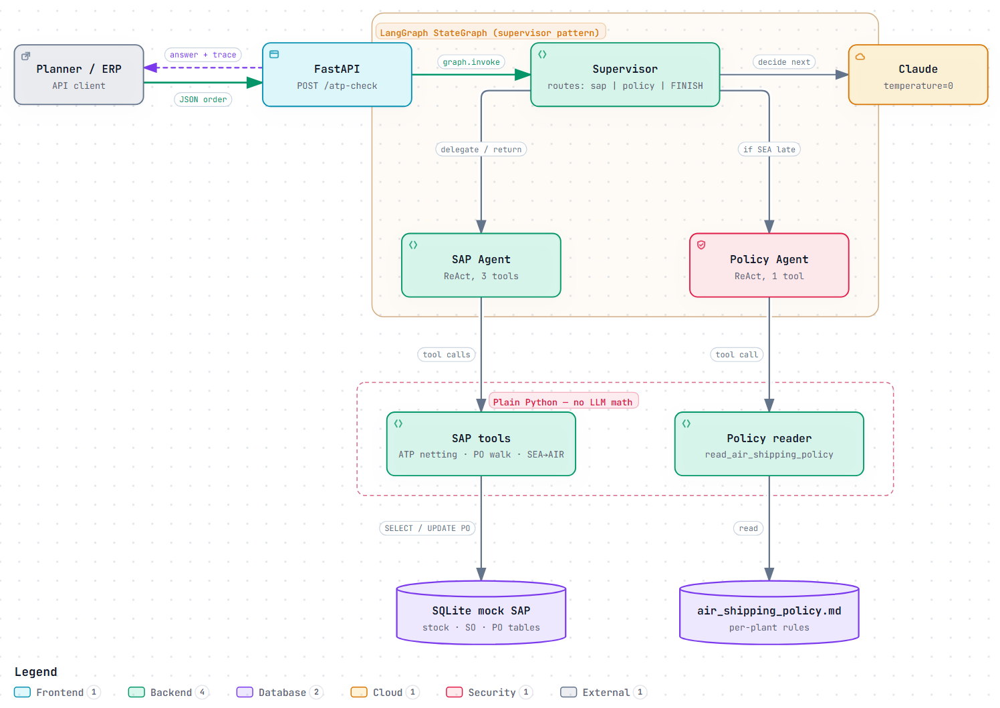
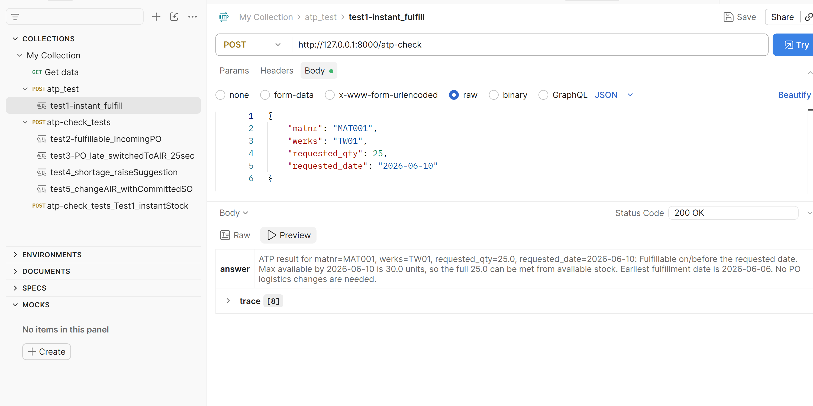
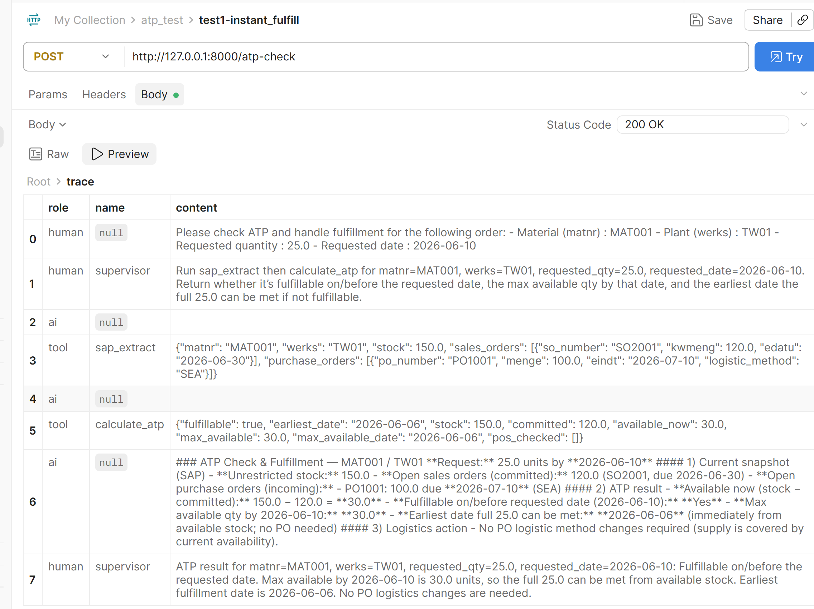
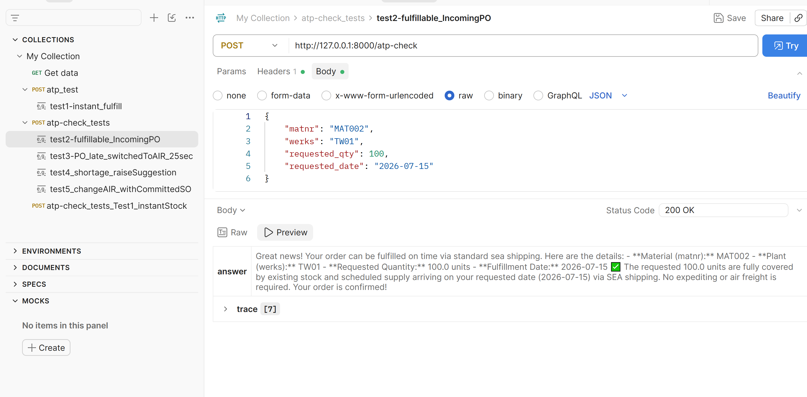
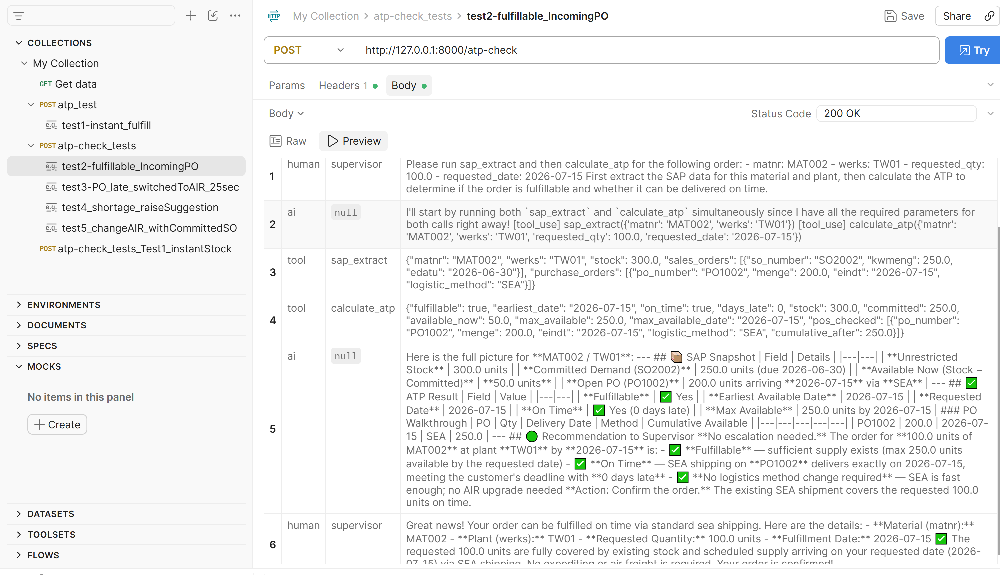
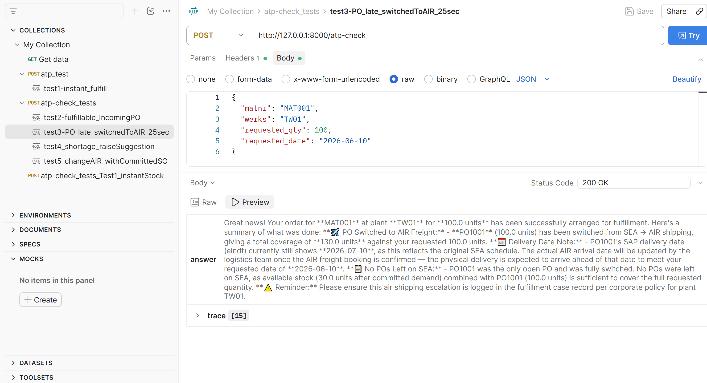
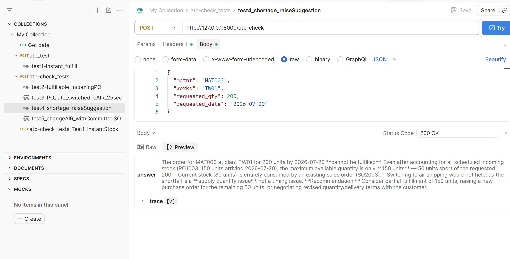
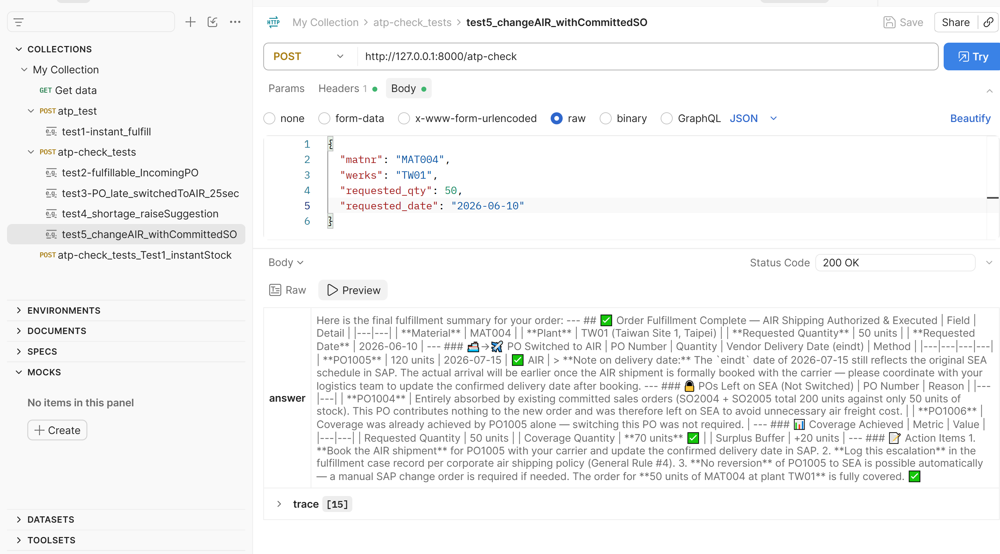

# askATP — Agentic Order-Fulfillment Copilot for Supply Chain Planners

A **FastAPI + LangGraph** multi-agent system that mirrors SAP-style **Available-to-Promise (ATP)** checks. When sea freight cannot meet the customer's requested delivery date, it proposes an **air shipping** upgrade and waits for a planner to approve it.

`Python` · `FastAPI` · `LangGraph` · `LangChain` · `Claude (Anthropic)` · `Pydantic v2` · `SQLite`

> *"Can we promise this customer X units by date Y? And if not, what is the cheapest compliant way to get there?"*

Whether it comes from sales, a customer's online order, or an ERP alert, answering this question is a core part of a fulfillment planner's job, for every part they own. It means netting stock against orders and incoming supply, checking shipping options and policy, and often involving other teams.

**askATP automates the repeatable core of that workflow behind one API call, plus a planner approval call whenever a PO would change.** A LangGraph multi-agent system has three agents. A **Supervisor** routes the work the way a planning team would. A **SAP Agent** runs deterministic ATP math and proposes PO changes. A **Policy Agent** reads plant-level logistics rules and decides whether escalation is allowed. Before any PO is changed, the workflow **pauses for a planner to approve** and resumes when the approval call arrives. Each response contains the decision and a full audit trace of how it was reached.




### Why it's more than an LLM demo

| | |
|---|---|
| **Built on real planning logic** | [The ATP check](#1-the-atp-check-when-can-we-deliver) works the way planners do: stock minus units already promised to customers, then incoming POs added in order of arrival. [PO selection](#3-which-pos-get-switched-to-air) skips POs whose units are already owed to existing orders, so air freight is only paid for where it actually helps the new order. |
| **Deterministic where it must be, AI where it helps** | Quantities and dates are computed in plain Python, never by the LLM. The LLM is used only for routing, interpreting policy text and writing the summary. `temperature=0` keeps routing as repeatable as possible; it isn't a hard guarantee, which is why nothing that must be exact depends on the LLM. |
| **Policy as a document** | Air-freight authorization lives in [a Markdown file](policies/air_shipping_policy.md) covering per-plant rules, quantity thresholds and cost-reduction freezes. Logistics can change the rules without a code deploy. |
| **A human signs off, enforced in code** | The approval gate sits inside the PO-change tool (LangGraph `interrupt`), not in a prompt, so no routing decision by the LLM can change a PO without a planner's approval. If SAP data changes while a proposal waits so that different POs would be switched, the approval is refused as stale. |
| **Auditable by design** | Every tool call and every reasoning step is returned in `trace`. Every approval, rejection or stale refusal is appended to an `approval_log` table. Compliance can reconstruct why a PO was switched, which policy clause allowed it and who approved it. |
| **Built to scale** | Tools are plain functions with dict inputs and outputs, so they can later be exposed as MCP servers (Model Context Protocol). The SQLite mock maps one-to-one to SAP objects (see [How this maps to SAP](#4-how-this-maps-to-sap)), so a real RFC/BAPI connector can replace it without changing agent logic. |

### Technical highlights

| Layer | Implementation |
|---|---|
| **API** | FastAPI + Uvicorn. `POST /atp-check` takes `matnr, werks, requested_qty, requested_date` ([SAP field names](#sap-field-name-glossary)) and returns `{status, thread_id, answer, proposal, trace}`. `POST /approve/{thread_id}` takes the planner's decision and resumes the run. Requests and responses are validated with Pydantic. The agent graph is compiled once at startup (FastAPI `lifespan`). |
| **Orchestration** | LangGraph `StateGraph` using a supervisor pattern. The Supervisor returns a typed `SupervisorDecision` (structured output: `sap_agent \| policy_agent \| FINISH`), so routing is a schema-validated choice, not free text. Shared state is a message list merged with `add_messages`. |
| **Human-in-the-loop** | `interrupt()` inside the PO-change tool pauses the whole graph, including the sub-agent it runs in. A `SqliteSaver` checkpointer stores the paused run in `checkpoints.db`, so it survives a server restart. `/approve` resumes it with `Command(resume=...)`. |
| **Agents** | Two ReAct sub-agents (`create_react_agent`), each limited to its own tools. **SAP Agent:** `sap_extract`, `calculate_atp`, `po_logistic_method_change`. **Policy Agent:** `read_air_shipping_policy`. Each sub-agent returns control to the Supervisor after every turn. |
| **LLM** | Claude via `langchain-anthropic` at `temperature=0`. The model is set through `ANTHROPIC_MODEL` in `.env`. |
| **Tools / business logic** | Plain Python functions with typed inputs and dict outputs, wrapped with `@tool`, so the docstrings become the tool descriptions the LLM reads. |
| **Tests** | `pytest`, no API key needed. The tools are tested directly. The approval flow and the API run through the real supervisor graph, with a scripted chat model standing in for Claude. |
| **Data** | SQLite mock of SAP tables (`stock`, `sales_orders`, `purchase_orders`, `material_master`) using SAP field names (`matnr`, `werks`, `labst`, `menge`, `eindt`), plus an append-only `approval_log`. `setup_db.py` reseeds it to a known state for repeatable tests. |
| **Observability** | Every response includes the full message trace: supervisor decisions, tool calls with arguments, and tool results. Each routing step and tool call is also logged to the console, along with total request time. |

**Scope of this repo:** it implements the core escalation path: the ATP check, then the SEA→AIR mode upgrade, gated by policy and by planner approval. It is the first slice of the full planner workflow described in [Where this is going](#where-this-is-going--the-full-planner-workflow).

**Why multi-agent for this slice?** On its own, this slice is a fixed decision table and could be a plain function. It's built as a supervisor with sub-agents because the full workflow isn't a fixed table. Requests arrive as free text, some steps are open-ended (finding a shortage's root cause), and each lever has its own data and rules: credit hold, cross-plant transfer, work-order expedite, rework. With a supervisor, adding a lever means adding one agent and one routing rule, not rewriting the control flow. Each agent can only use its own tools, so the Policy Agent can never touch a PO. Anything that must be correct is enforced in code, not in prompts: the ATP math, PO selection and the approval gate. So the LLM's routing can change which path a request takes, but never the numbers, and never without a planner's sign-off.

Not a developer? The [CIO brief](https://hpchou2.github.io/askATP-agent/CIO_Brief.html) explains the business case on one page (see [Related documents](#related-documents)).

---

## How it works

The agents automate one planning check called **Available-to-Promise (ATP)**. This section explains the check itself, then how the agents act on its result, then which POs get switched to air. The last part shows how each piece lines up with SAP.

### 1. The ATP check: when can we deliver?

ATP answers one question: **what is the earliest date we can deliver X units to this customer**, given the stock on hand and the supply already on the way?

1. **Free stock** = stock on hand − units already promised to existing customer orders. It can be negative when more has been promised than is on hand.
2. If free stock covers the request, the order can be confirmed now.
3. If not, add incoming purchase orders (POs) one by one, in order of arrival date, until the request is covered. That PO's arrival date is the earliest delivery date.
4. If all incoming POs together still fall short, the request can't be met in full. The answer is the maximum quantity available and when.

*Example (material MAT001):* 150 in stock − 120 already promised = 30 free. A request for 100 units needs PO1001 (+100, arriving 2026-07-10), so the earliest delivery date is 10 July.

This calculation is plain Python in `calculate_atp()`.

### 2. The agent workflow: what happens with the result

ATP produces two facts. `fulfillable` means the quantity can be covered at some point. `on_time` means it's covered by the requested date. The Supervisor routes on those two facts:

```
START
  │
  ▼
Supervisor ──► SAP Agent: sap_extract + calculate_atp
  │
  ├── fulfillable=True,  on_time=True  ──────► FINISH  "fulfillable by <date> via SEA"
  │
  ├── fulfillable=False  ────────────────────► FINISH  "cannot fulfill, max available = X"
  │
  └── fulfillable=True,  on_time=False
        │   (quantity is available but SEA arrives too late)
        ▼
      Supervisor ──► Policy Agent: read_air_shipping_policy
        │
        ├── AIR NOT PERMITTED ───────────────► FINISH  "shortage, air blocked — reason: ..."
        │
        └── AIR PERMITTED
              │
              ▼
            Supervisor ──► SAP Agent: po_logistic_method_change → AIR
              │
              ▼
            ⏸ PAUSE: proposal returned to the caller (status = PENDING_APPROVAL)
              │   run saved by the checkpointer; resumes on POST /approve/{thread_id}
              │
              ├── APPROVED ──► POs switched ──► FINISH  "switched PO(s) to AIR, approved by …"
              ├── REJECTED ──► nothing changed ► FINISH  "stays on SEA, earliest date …"
              └── data changed while waiting ──► FINISH  "proposal is stale, run the check again"
```

Every decision (approved, rejected or stale) is appended to the `approval_log` table.

Air freight is only considered when the quantity exists but arrives too late. When the quantity doesn't exist at all, flying it in faster can't help, so the agent reports the shortage instead.

### 3. Which POs get switched to air

Air freight is expensive, so the PO selection (`plan_po_logistic_change()`, applied by `execute_po_logistic_change()` after approval) switches as few POs as possible. It goes through POs in arrival order and keeps a running total:

```
running = stock − committed_SOs + PO₁ + PO₂ + … + POᵢ
```

`stock` is the quantity on hand, `committed_SOs` is the quantity already promised to open sales orders (together they make the free stock from §1), and PO₁ … POᵢ are the incoming POs added so far, earliest arrival first.

- **Skip** POs while `running < 0`, since those units are already owed to existing customer orders. These POs are left untouched
- **Switch** from the first PO that brings `running >= 0` (SO commitments are now fully covered). Switch this PO and every subsequent PO until `running ≥ requested_qty` (the decisive PO)
- **Leave** every later PO on sea.

If `stock − committed_SOs ≥ 0` from the start (no SO deficit), switching begins with the first PO.

If the POs can't cover the full request, nothing is switched. Paying for air freight that doesn't solve the order would only add cost.

*Example (material MAT004, [Test 5](#test-5--skip-a-po-already-owed-to-existing-orders)):* free stock is −150. PO1004 (+100) only brings the total to −50, so it stays on sea. PO1005 (+120) brings it to +70, which covers the 50-unit request, so only PO1005 is switched. PO1006 is untouched.

### 4. How this maps to SAP

Every concept above has a direct SAP counterpart. The mock database and functions use the same names and structure, so a real SAP connection could replace SQLite without changing the agents.

| Planning concept | SAP object / transaction | In this repo |
|---|---|---|
| Stock on hand | MARD-LABST · MMBE | `stock` table |
| Units promised to customers | VBAP / VBBE · open sales orders | `sales_orders` table |
| Incoming supply | EKPO / EKET · ME23N | `purchase_orders` table |
| The ATP check | CO09 · `BAPI_MATERIAL_AVAILABILITY` | `calculate_atp()` |
| Changing a PO's freight mode | ME22N (shipping instructions / schedule lines) | `execute_po_logistic_change()` |
| Approving the change, and the record of it | Release strategy (ME28/ME29N) · change documents (CDHDR / CDPOS) | `interrupt()` + `POST /approve` · `approval_log` table |
| Freight policy | Corporate logistics guideline | `policies/air_shipping_policy.md` |

---

## Prerequisites

- Python 3.10+
- An Anthropic API key — get one at https://console.anthropic.com

---

## Setup

```bash
# 1. Create a virtual environment and install dependencies
python -m venv .venv
source .venv/bin/activate          # Windows: .venv\Scripts\activate
pip install -r requirements.txt

# 2. Copy the environment template and add your API key
cp .env.example .env               # Windows: copy .env.example .env
# Edit .env:  ANTHROPIC_API_KEY=sk-ant-...

# 3. Create and seed the mock SAP database (re-run any time to reset; stop the server first)
python setup_db.py

# 4. Start the API server
uvicorn api:app --reload
```

The server starts at **http://127.0.0.1:8000**. Interactive Swagger docs are at **http://127.0.0.1:8000/docs**.

### Try it

`setup_db.py` prints a ready-to-use request body for each [test scenario](#test-scenarios). Send one with curl (macOS, Linux or Git Bash), or paste it into the Swagger page:

```bash
curl -X POST http://127.0.0.1:8000/atp-check \
  -H "Content-Type: application/json" \
  -d '{"matnr": "MAT001", "werks": "TW01", "requested_qty": 20, "requested_date": "<date printed by setup_db.py>"}'
```

If the response has `"status": "PENDING_APPROVAL"`, approve (or reject) it with the `thread_id` from that response:

```bash
curl -X POST http://127.0.0.1:8000/approve/<thread_id> \
  -H "Content-Type: application/json" \
  -d '{"approved": true, "approver": "your.name", "comment": "optional"}'
```

`python setup_db.py` also clears any runs still waiting for approval, since they refer to the old data. Stop the server before running it.

---

## API Reference

### `GET /health`

Liveness check.

```json
{ "message": "service is running" }
```

### `POST /atp-check`

Run the full multi-agent ATP fulfillment workflow.

**Request body:**

```json
{
  "matnr":          "MAT001",
  "werks":          "TW01",
  "requested_qty":  100,
  "requested_date": "2026-06-10"
}
```

| Field | Type | Required | Description |
|---|---|---|---|
| `matnr` | string | ✓ | Material number |
| `werks` | string | ✓ | Plant code (default: `TW01`) |
| `requested_qty` | float | ✓ | Quantity the customer needs (must be > 0) |
| `requested_date` | string | ✓ | Customer's required delivery date — `YYYY-MM-DD` |

**Response:**

```json
{
  "status":    "PENDING_APPROVAL",
  "thread_id": "e6270f0a-46ce-4171-b7d8-350b50496fc1",
  "answer":    "Approve switching PO1001 to AIR to cover 100 units of MAT001 at TW01?",
  "proposal": {
    "type": "po_logistic_method_change",
    "matnr": "MAT001", "werks": "TW01", "requested_qty": 100, "method": "AIR",
    "proposed_pos":  [{ "po_number": "PO1001", "eindt": "2026-12-15", "menge": 100,
                        "old_method": "SEA", "new_method": "AIR", "cumulative_after": 130 }],
    "remaining_pos": [],
    "coverage_qty":  130,
    "message": "Approve switching PO1001 to AIR ..."
  },
  "trace": [
    { "role": "human", "name": null,         "content": "Please check ATP ..." },
    { "role": "human", "name": "supervisor", "content": "Run calculate_atp for MAT001 ..." },
    { "role": "ai",    "name": null,         "content": "[tool_use] calculate_atp({...})" },
    { "role": "tool",  "name": "calculate_atp", "content": "{'fulfillable': True, 'on_time': False, ...}" }
  ]
}
```

| Field | Description |
|---|---|
| `status` | `COMPLETED` (the answer is final) or `PENDING_APPROVAL` (a PO switch is waiting for a planner) |
| `thread_id` | ID of this workflow run. Pass it to `POST /approve/{thread_id}` |
| `answer` | The supervisor's final summary, or the approval question when pending |
| `proposal` | The proposed PO switch. Only present when `PENDING_APPROVAL` |
| `trace` | Every message so far: supervisor instructions, tool calls and tool results |

### `POST /approve/{thread_id}`

Approve or reject the proposal a run is paused on, then resume the run to the end.

**Request body:**

```json
{ "approved": true, "approver": "angela.chou", "comment": "Strategic customer" }
```

| Field | Type | Required | Description |
|---|---|---|---|
| `approved` | bool | ✓ | `true` switches the proposed POs; `false` changes nothing |
| `approver` | string | ✓ | Who is deciding. Stored in `approval_log` |
| `comment` | string | | Optional note. Stored in `approval_log` |

**Response:** the same shape as `/atp-check`, with `status: "COMPLETED"` and the final answer. If stock, orders or POs changed while the run was waiting, the approval is refused as stale and nothing is changed.

| Error | When |
|---|---|
| `404` | No run with that `thread_id` |
| `409` | The run isn't waiting for approval (already decided, or never needed it) |
| `422` | Missing `approved` or `approver` |

---

## Seed data

`setup_db.py` creates one plant (**TW01**, Taiwan Site 1, warehouse **WH01**) with four materials. All dates are relative to the day you run it, so the scenarios below give the same results whenever they are run.

| Material | Description | Stock | Promised to customers | Free stock | Incoming POs (all SEA) |
|---|---|--:|--:|--:|---|
| MAT001 | Server CPU Module | 150 | 120 | 30 | PO1001: +100, today + 40 days |
| MAT002 | Memory 32GB | 300 | 250 | 50 | PO1002: +200, today + 45 days |
| MAT003 | NVMe SSD 1TB | 80 | 80 | 0 | PO1003: +150, today + 50 days |
| MAT004 | Graphics Card 8GB | 50 | 200 (2 orders) | −150 | PO1004: +100, today + 35 days · PO1005: +120, today + 45 days · PO1006: +100, today + 55 days |

Existing customer orders are all due today + 30 days. Re-run `python setup_db.py` at any time to reset the database.

---

## Test scenarios

Five scenarios cover every branch of the [agent workflow](#2-the-agent-workflow-what-happens-with-the-result).

**Automated tests.** `pytest` runs against a temporary copy of the seed data. No API key is needed:

- `tests/test_sap_tools.py`: the ATP math, PO selection and PO switching for all five scenarios, plus the approval log
- `tests/test_approval.py`: the approval step through the real supervisor graph, with a scripted chat model in place of Claude. It pauses before any PO changes; approve switches only PO1005; reject changes nothing; a stale proposal is refused
- `tests/test_api.py`: `/atp-check` and `/approve` end to end, including the 404, 409 and 422 errors

```bash
python -m pytest
```

**End-to-end runs.** To run a scenario through the full agent system, send its request to `POST /atp-check` (see [Try it](#try-it)). Dates are written as `today+n`, meaning n days after you ran `setup_db.py`, which prints each request with the real dates filled in. The screenshots below come from earlier runs, so the dates in them differ from yours. Tests 1, 2 and 4 were captured before the approval step existed, so their responses don't yet show the `status` and `thread_id` fields.

### Test 1 — Fulfillable from current stock (on time)

```json
{ "matnr": "MAT001", "werks": "TW01", "requested_qty": 20, "requested_date": "<today+10>" }
```

- `available_now = 150 − 120 = 30 ≥ 20` → fulfillable today, on time
- **Agent flow:** supervisor → sap_agent → supervisor FINISH
- **Expected answer:** Order confirmed from available stock




### Test 2 — Covered by an incoming PO, on time

```json
{ "matnr": "MAT002", "werks": "TW01", "requested_qty": 100, "requested_date": "<today+45>" }
```

- `available_now = 300 − 250 = 50` (not enough)
- PO1002 arrives today+45 (+200 units) → cumulative = 250 ≥ 100 → `earliest_date = today+45`, exactly on the requested date.
- `on_time = True` (today+45 ≤ today+45)
- **Agent flow:** supervisor → sap_agent → supervisor FINISH
- **Expected answer:** Order fulfillable by today+45




### Test 3 — Sea is too late, switched to air

```json
{ "matnr": "MAT001", "werks": "TW01", "requested_qty": 100, "requested_date": "<today+10>" }
```

- `available_now = 30` (not enough). PO1001 (+100) brings the total to 130, but it arrives today + 40 days → `on_time = False` (30 days late)
- TW01 policy: AIR **PERMITTED** with no minimum quantity
- PO selection: `available_now = 30 > 0`, so no PO is owed to existing orders and none needs to be skipped. PO1001 alone covers the request (30 + 100 = 130 ≥ 100) and is proposed for AIR.
- **Agent flow:** supervisor → sap_agent (sap_extract + calculate_atp) → supervisor → policy_agent → supervisor → sap_agent (po_logistic_method_change) → ⏸ planner approval → supervisor FINISH
- **Step 1, `POST /atp-check`:** `status = PENDING_APPROVAL`, proposal = PO1001. PO1001 is still SEA in the database
- **Step 2, `POST /approve/{thread_id}`** with `{"approved": true, "approver": "..."}`: PO1001 switched to AIR, one `APPROVED` row in `approval_log`. Sending `"approved": false` instead leaves PO1001 on SEA, and the answer gives the earliest sea date



### Test 4 — Not enough stock at all

```json
{ "matnr": "MAT003", "werks": "TW01", "requested_qty": 200, "requested_date": "<today+50>" }
```

- `available_now = 80 − 80 = 0`. PO1003 arrives today+50 (+150) → max available = 150 < 200 → `fulfillable = False`
- AIR freight doesn't create new stock, so no escalation is attempted
- **Agent flow:** supervisor → sap_agent → supervisor FINISH
- **Expected answer:** Cannot fulfill — maximum available is 150 pcs on today+50



### Test 5 — Skip a PO already owed to existing orders

```json
{ "matnr": "MAT004", "werks": "TW01", "requested_qty": 50, "requested_date": "<today+10>" }
```

- `available_now = 50 − 200 = −150` — committed SOs exceed current stock; the first POs are entirely absorbed by SO demand
- PO walk:
  - PO1004 (+100) only brings the total to −50. Its units are still owed to existing customers → **skip**
  - PO1005 (+120) brings the total to +70, which covers 50 units.→ **switch**.  
  - PO1006 → coverage already reached → **leave untouched**
- `on_time = False` (35 days late). TW01 policy: AIR **PERMITTED**
- `po_logistic_method_change` proposes PO1005 only: PO1004 stays on SEA (serves committed SOs) and PO1006 is untouched
- **Agent flow:** supervisor → sap_agent (sap_extract + calculate_atp) → supervisor → policy_agent → supervisor → sap_agent (po_logistic_method_change) → ⏸ planner approval → supervisor FINISH
- **Step 1, `POST /atp-check`:** `status = PENDING_APPROVAL`, `proposed_pos` = PO1005, `remaining_pos` = PO1004, PO1006
- **Step 2, `POST /approve/{thread_id}`:** only PO1005 switched to AIR; PO1004 and PO1006 left on SEA



---

## Known limitations

This is a working prototype of one slice of the workflow. Things it deliberately doesn't do yet:

- **Whole POs are switched, not exact quantities.** If a 120-unit PO is switched to cover 50 units, all 120 go by air.
- **Delivery dates aren't recalculated after a switch.** A PO switched to AIR keeps its sea arrival date until a real air booking provides a new one.
- **Mock data only.** One plant, four materials, SQLite. There's no live SAP connection.
- **No authentication** on the API. Anyone who can reach `/approve` can approve, and `approver` is whatever name the caller sends. In production the approver would come from the login and be checked against an approval matrix.
- **Air freight isn't checked against the requested date.** Air lead times aren't modeled, so the system can't yet confirm that switching to air actually arrives in time.
- **One approval edge case isn't logged.** If stock, orders or POs change so much while a proposal waits that the POs can no longer cover the order, the resumed run reports a shortage and changes nothing, but the planner's decision isn't written to `approval_log`.
- **Latency.** The supervisor and sub-agents make LLM calls one after another. In the latest run, the air escalation path took about 50 seconds to reach the approval step and about 25 more after approval.

---

## Where this is going — the full planner workflow

Air freight is only **one** of the levers a fulfillment planner can pull. When a request can't be met, a planner works through the options in a fixed order, starting with the least disruptive and cheapest, and stops at the first one that works. This repo automates one of those levers. The target design covers all of them.

An interactive version of this design is in [docs/atp_langgraph_v4.html](https://hpchou2.github.io/askATP-agent/atp_langgraph_v4.html). Open it to click through each node.

### Waterfall view: how a planner actually triages

The waterfall view is the realistic **default** for day-to-day fulfillment work. A planner doesn't ask the factory to expedite a work order if moving stock between plants already solves the problem. Every later step costs more money or more goodwill with another team.

```
① INTAKE        check_credit_hold (VKM1)    → credit-blocked orders go to Finance; triage pauses
                parse_request               → classify PULL_IN (sales or customer self-service inquiry) vs OVER_COMMIT (ERP-detected slip)
② INVENTORY     01 destination ATP (CO09) + quality-block check (QM)  → enough on time? auto-confirm, exit early
                   check_open_sea_order     → air is a mode upgrade of an existing shipment, not a new source
                02 air upgrade on the open sea order  ◄── implemented in this repo
                   (only while the container is still booking / pre-loading)
③ POLICY        evaluate every option against the logistics / manufacturing / inventory policy → PASS · FLAG · BLOCK
④ RESOLUTION    03 cross-plant inventory → STO   (duty-paid plants first; split across sources)
                04 work-order expedite           (CO03 / MES; yield-adjusted output; overtime needs mfg approval)
                05 rework / BOM alternative      (CS03; MOQ from MARC / EINA; always needs PM approval)
                06 shortage root cause           → escalate to Sourcing · QM · Logistics · Engineering · Demand Planning
⑤ COMPOSE+HITL  commit date · confidence · binding constraint · ranked options
                → planner confirms / rejects / asks for alternatives → execute → append-only audit log
```

### Parallel view: rank every option at once

For **OVER_COMMIT** events and **batch backlog reprioritization**, the planner wants all feasible options compared side by side, not just the first one that works. The parallel view runs steps 02–06 concurrently (`asyncio.gather`). It collects one row per option and ranks them by cost, confidence (adjusted for production yield) and arrival date. The destination ATP check still runs first so that a simple case exits early.

### Domain rules built into the design

- **Dates mean arrival at the destination, including goods receipt.** Source-plant ATP is checked against `requested_date − transit_days`. Mixing source and destination dates is a classic over-promising bug.
- **A shipment that is already loaded or departed can't be split or upgraded.** Only open bookings can.
- **Restricted stock is a different problem from a shortage.** When CO09 shows 0 but MMBE shows physical stock, the stock is in quality inspection, blocked or in transit. The right answer is an advisory to the owning team, not an escalation to Sourcing.
- **Work-order output is adjusted for yield.** A 100-unit WO at 93% yield gives 93 sellable units.
- **Human-in-the-loop by default.** Expensive air freight, rework and late or partial fills always go to a named approver. Nothing affecting customer commitments is posted automatically.

| Capability | Status |
|---|---|
| ATP netting + PO walk + break-even PO selection | ✅ Implemented |
| Policy-gated SEA→AIR upgrade | ✅ Implemented |
| Exact-quantity schedule-line split for AIR | 🛠 Next |
| Human approval gate (LangGraph `interrupt` + SQLite checkpointer) and approval log | ✅ Implemented |
| Credit hold, QM block, cross-plant STO, WO expedite, rework, shortage root cause | 📐 Designed |
| Parallel ranking mode, batch reprioritization, append-only audit DB | 📐 Designed |

---

## Related documents

This README is the technical entry point. Two shorter documents cover the business side:

| Document | What it is | Who it's for |
|---|---|---|
| [docs/CIO_Brief.html](https://hpchou2.github.io/askATP-agent/CIO_Brief.html) | One-page business case: the problem, architecture, where the AI is used, assumptions and constraints, and the path from prototype to production. | CIO, IT and supply-chain leadership, hiring managers |
| [docs/CIO_Talking_Points.md](docs/CIO_Talking_Points.md) | A 2–3 minute spoken walkthrough of the same story: opening, problem, architecture and decision matrix. | Whoever presents the project in a meeting or interview |

---

## File Structure

```
askATP_simple/
├── api.py                        — FastAPI app, lifespan, /health, /atp-check and /approve endpoints
├── setup_db.py                   — creates and seeds sap_mock.db (dates relative to today)
├── requirements.txt
├── LICENSE
├── .env.example                  — copy to .env and fill in ANTHROPIC_API_KEY
│
├── agents/
│   ├── supervisor.py             — LangGraph StateGraph + supervisor routing logic
│   ├── sap_agent.py              — ReAct agent wrapping the three SAP tools; holds the approval gate
│   └── policy_agent.py           — ReAct agent wrapping the policy file reader
│
├── tools/
│   ├── sap_tools.py              — sap_extract, calculate_atp, plan/execute_po_logistic_change, log_approval
│   └── policy_tools.py           — read_air_shipping_policy
│
├── tests/
│   ├── conftest.py               — temp database fixture and scripted chat model
│   ├── test_sap_tools.py         — the five scenarios against the tools (no API key needed)
│   ├── test_approval.py          — approve / reject / stale through the real graph
│   └── test_api.py               — /atp-check and /approve end to end
│
├── policies/
│   └── air_shipping_policy.md    — per-plant AIR shipping authorization rules
│
├── docs/                         — the only folder published by GitHub Pages
│   ├── CIO_Brief.html            — business case, assumptions, roadmap
│   ├── CIO_Talking_Points.md     — 2–3 min spoken walkthrough for presenting
│   ├── atp_langgraph_v4.html     — interactive target architecture (full planner workflow)
│   ├── diagrams/                 — architecture and approval-flow diagram sources (Archify JSON)
│   └── images/                   — architecture and approval-flow diagrams, test screenshots
│
├── sap_mock.db                   — generated by setup_db.py (do not edit by hand)
└── checkpoints.db                — paused workflow runs (created by the API; cleared by setup_db.py)
```

---

## SAP Field Name Glossary

| SAP Field | Meaning |
|-----------|---------|
| `matnr`   | Material number — unique product ID |
| `maktx`   | Material description — product name |
| `meins`   | Base unit of measure (`PC` = pieces) |
| `mtart`   | Material type (`FERT` = finished manufactured good) |
| `werks`   | Plant — the facility / site code |
| `lgort`   | Storage location within a plant |
| `labst`   | Unrestricted-use stock — quantity freely available to sell or ship |
| `menge`   | Quantity (on a PO line) |
| `eindt`   | Expected goods receipt date (PO delivery date) |
| `kwmeng`  | Confirmed quantity on a sales order |
| `edatu`   | Customer's requested delivery date on a sales order |
